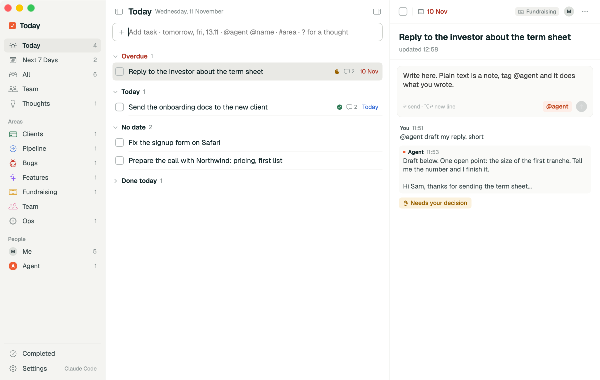

# Today

**A free, open source task app for macOS. Bring your own Claude or ChatGPT account.**

Capture a task from any app with ⌃⌥Space. Add `@agent` to get a draft, plan or answer in that task's conversation. Connect your own Claude Code or Codex login, an API account, or a local model.

Built by [Dmitry Ostrovtsev](https://www.linkedin.com/in/dostrovcev/), founder of [Re:Vault](https://re-vault.io/?utm_source=revault-today&utm_medium=github&utm_campaign=open-source).

## What works

- Today, Next 7 Days, All, Team, Thoughts and Completed views.
- Quick capture with dates (`tomorrow`, `fri`, `13.11`), `#areas` and `@people`.
- A conversation in each task. Add `@agent` to request help.
- Local storage, configurable areas and people, and no Re:Vault account.

The Team view organizes tasks by people you enter; it does not synchronize with teammates. AI returns drafts and answers inside the app. It does not automatically send email or book appointments.



## Build and install

[Download the Apple Silicon preview (v0.1.0)](https://github.com/dostrovcev/revault-today/releases/tag/v0.1.0). It is an early, ad hoc signed build; Google/AI account setup is still required.

Requires macOS 14+ and Xcode command line tools (`xcode-select --install`).

```bash
git clone https://github.com/dostrovcev/revault-today.git
cd revault-today
./scripts/build_app.sh
```

Copy `build/Today.app` into Applications. Builds are ad hoc signed, not notarized. If macOS blocks opening it, use Privacy & Security after reviewing the source.

## Choose your AI

Open Settings → Agent:

| Connection | Setup |
|---|---|
| Claude Code | Install the CLI, run `claude`, and sign in with your account. |
| Codex / ChatGPT | Install Codex CLI, run `codex login`, and sign in with ChatGPT. |
| Anthropic or OpenAI API | Enter your own API key and a model ID available to your account. |
| OpenAI-compatible | Enter the base URL and model for Ollama, LM Studio or another compatible service. |

The app is free. Your provider controls AI eligibility, limits and charges. API usage follows your API account's billing; it is not automatically covered by a chat subscription. A locally running model can work without a cloud AI subscription.

[Connection instructions](docs/AI-SETUP.md). API keys use macOS Keychain. Tasks live in `~/Library/Application Support/Today`. Invoking AI sends that task and its recent comments to the selected provider. There is no Re:Vault backend or analytics service.

## Develop

```bash
swift build
bash scripts/test_agent.sh
TODAY_DEMO=1 swift run Today
```

The app uses SwiftUI with no third-party package dependencies. Demo tasks are fictional.

## Author and related project

I build AI tools for the work I do every day. If you want help applying AI to your sales workflow, [see my work at Re:Vault](https://re-vault.io/?utm_source=revault-today&utm_medium=github&utm_campaign=open-source).

Also see [Re:Vault Mail](https://github.com/dostrovcev/revault-mail), a Gmail app with your own AI beside each thread.

MIT license. Geist fonts use the SIL Open Font License. [Contribute](CONTRIBUTING.md) · [Security](SECURITY.md) · [Roadmap](docs/ROADMAP.md).
